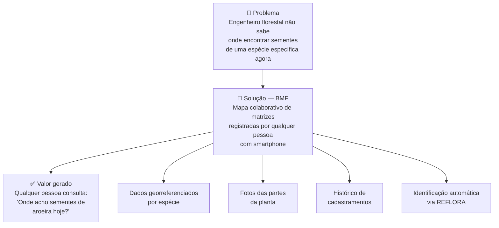
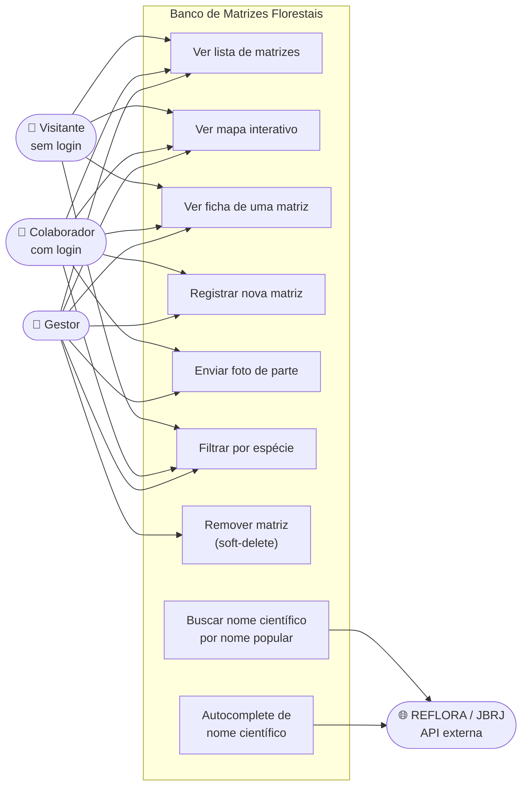
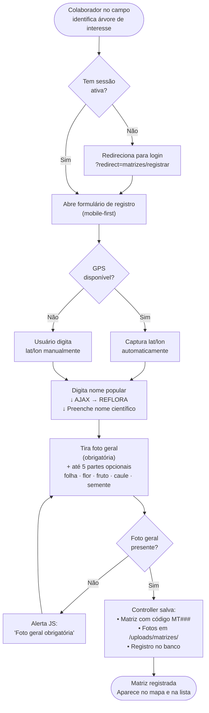
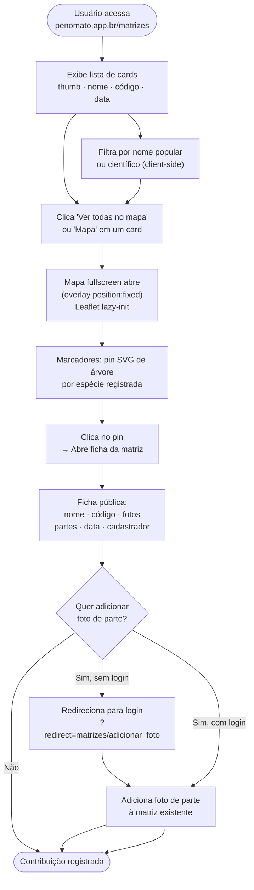
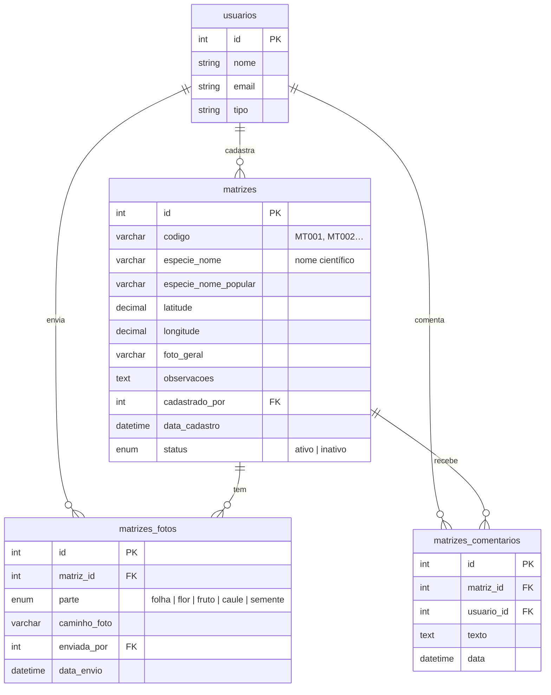
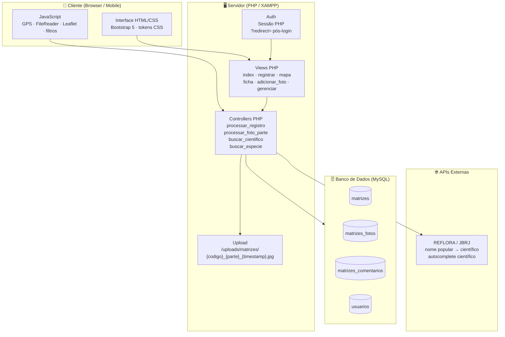

# Diagramas de Ideação — Banco de Matrizes Florestais (BMF)

Módulo colaborativo do Penomato para mapeamento de indivíduos arbóreos com potencial para coleta de material propagativo (sementes, estacas, propágulos).

---

## 1. Diagrama de Contexto

Problema central e valor gerado pelo módulo.

---

## 2. Diagrama de Atores e Casos de Uso

Quem interage com o sistema e o que cada ator pode fazer.

---

## 3. Fluxo do Usuário — Registrar uma Matriz

Jornada completa do colaborador pelo celular no campo.

---

## 4. Fluxo do Usuário — Consultar o Mapa

Jornada do visitante ou colaborador buscando matrizes sem login.

---

## 5. Modelo de Dados (ER)

Estrutura das três tabelas do módulo e seus relacionamentos.

---

## 6. Arquitetura do Sistema

Camadas técnicas do módulo e integrações externas.

